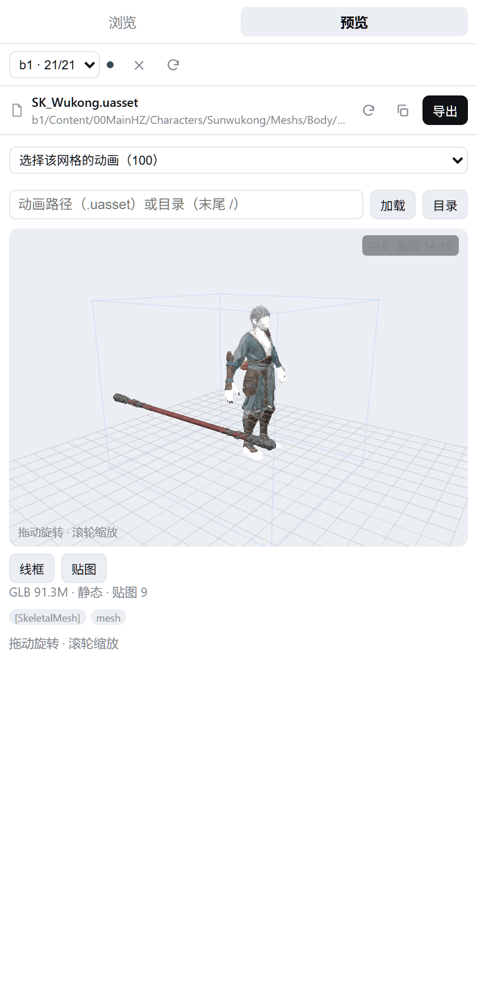
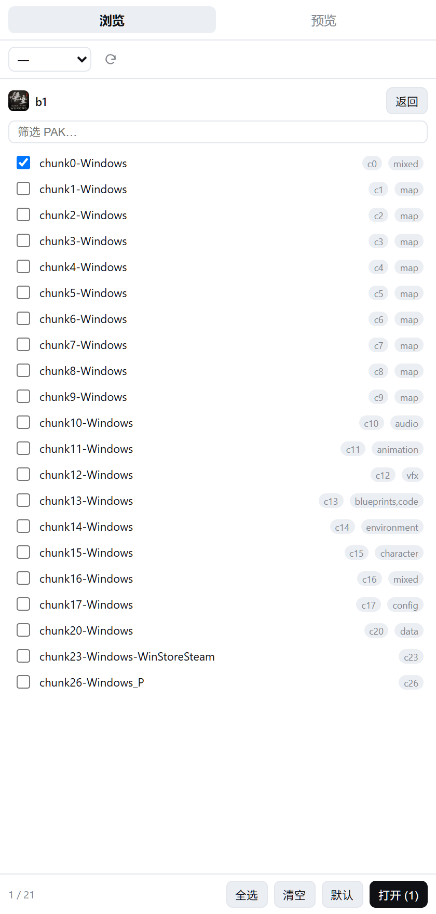
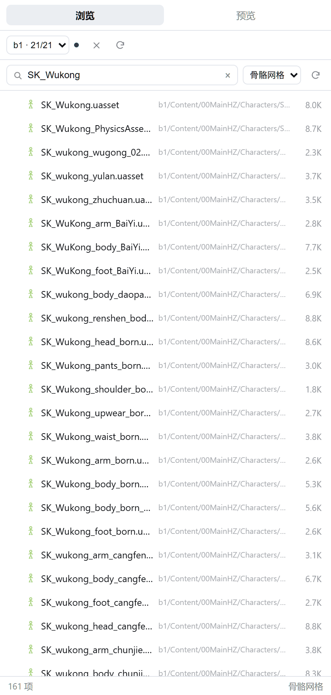
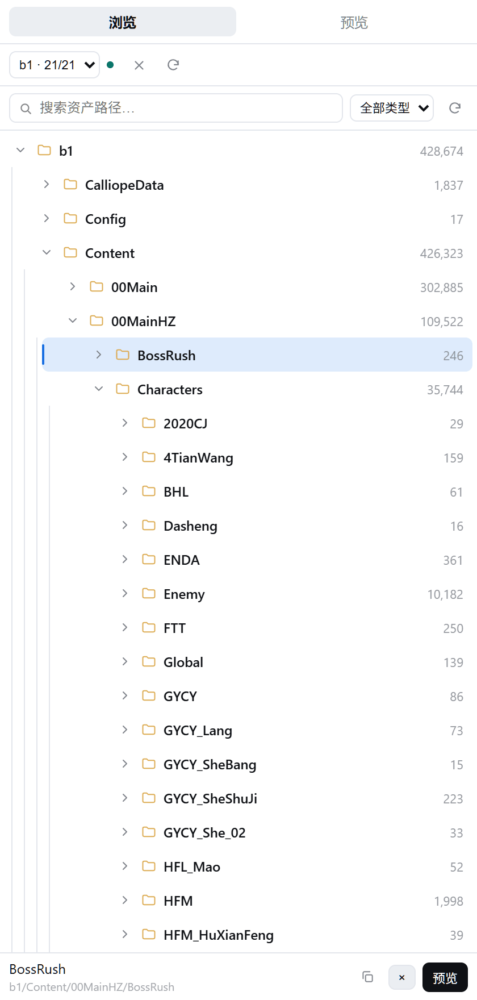
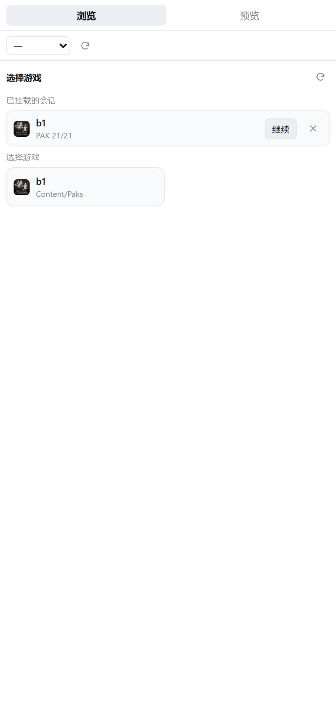
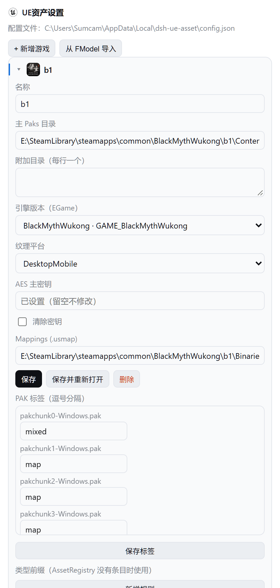

# dsh-ue-asset

本地 UE4/UE5 资产工具：一个 C# 核心 + CLI（`ueasset`），加一个 DeepSeek Harness 插件。
不需要 FModel 在跑，不需要联网，只读本地 PAK / IoStore，按需导出。

```
CUE4Parse (NuGet)  ──►  DshUeAsset.Core  ──►  ueasset CLI / serve
                                              ├── DSH Host 插件（17 个原生工具）
                                              └── DSH Client 插件（右栏 tab / 设置页 / 卡片）
```

## 截图

  

模型预览（`SK_Wukong.uasset` → GLB 91.3 MB，贴图与骨架都在）· 按 chunk 挂载 PAK · 路径搜索 + 类型筛选

  

目录树（层级引导线 + 每级计数）· 选择游戏（图标取自游戏 exe）· 设置页（引擎版本枚举 / PAK 标签 / AES）

## 当前状态

本机（.NET SDK 10.0.101 + CUE4Parse 1.2.2.202610 + 黑神话：悟空）已实测：

| 能力 | 状态 | 实测结果 |
|---|---|---|
| 挂载加密 PAK | ✅ | 21 个 PAK，missing=0，502,366 个虚拟路径，约 1.6 秒 |
| 目录浏览 / 路径搜索 | ✅ | `tree` / `find` |
| 属性读取 | ✅ | 依赖 usmap；缺失时明确报 `parser_error` |
| 纹理预览 | ✅ | `TextureDecoder` + `TextureEncoder` → PNG |
| 导出 | ✅ | `ExportSession.RunAsync`，产物约束在 job 目录内 |
| serve 协议 | ✅ | JSON-lines，stdin/stdout |
| DSH Host 工具 | ✅ | 17 个工具，smoke + 全链路测试通过 |
| DSH 右栏 / 设置页 | ✅ | `sidebar.right.pane.tab` + `settings.section` |
| 3D 模型预览 | ✅ | StaticMesh / SkeletalMesh → 自包含 GLB → three.js 视口（绑定姿势） |
| AI 模型返图 | ⬜ | 计划中（需要离屏 WebGL 往返） |

## 快速开始

```powershell
# 1. 构建
dotnet build src/DshUeAsset.Cli/DshUeAsset.Cli.csproj -c Release

# 2. 从 FModel 的 AppSettings.json 导入游戏（只读那个 JSON，不需要启动 FModel）
dotnet src/DshUeAsset.Cli/bin/Release/net10.0/ueasset.dll config import-fmodel

# 3. 补齐 Oodle（解压加密/压缩 PAK 必需）
#    设置 → UE资产设置 → Oodle 旁的「下载」按钮：优先用本机副本，找不到才从公开镜像下载；
#    也可以手动编辑 %LOCALAPPDATA%\dsh-ue-asset\config.json → "oodleLibrary"

# 4. 挂载 + 搜索 + 预览
ueasset open b1
ueasset find --profile b1 T_Boss --limit 10
ueasset preview --profile b1 <asset-path> --out out.png
```

CLI 每次调用都是独立进程；需要跨命令复用挂载时用 `serve`（DSH 插件就是这么做的）。

## 配置

`%LOCALAPPDATA%\dsh-ue-asset\config.json`，CLI 与插件共用：

```json
{
  "profiles": {
    "b1": {
      "name": "b1",
      "directory": "E:/.../BlackMythWukong/b1/Content/Paks",
      "extraDirectories": [],
      "game": "GAME_BlackMythWukong",
      "platform": "DesktopMobile",
      "aesKey": "0x...",
      "dynamicKeys": [],
      "usmap": "E:/.../Mappings.usmap"
    }
  },
  "outputRoot": "E:/WorkSpace/Tools/dsh-ue-asset/Exports",
  "oodleLibrary": "E:/.../oo2core_9_win64.dll",
  "defaultMeshFormat": "UEFormat"
}
```

密钥只存在这个文件里，**永远不经过工具参数**——DSH 会留存工具参数进对话历史。

## DSH 插件

`plugin/` 是一个标准 bundle：Host (`index.js`) + Client (`client.js`)，包名 `dsh-ue-asset`，`package.json` 里声明了 `dsh.bundle` + `dsh.client`，因此可以被 `dsh plugin add` 直接安装（也在 [awesome-dsh-plugin](https://github.com/awesome-dsh-plugin/awesome-dsh-plugin) 列表里）。

**装法一：预构建包（推荐，自带 `dist/ueasset.exe`）**

```powershell
dsh plugin --profile desktop add https://github.com/Sumcam-L/dsh-ue-asset/releases/latest/download/dsh-ue-asset.tgz
```

**装法二：npm**

```powershell
dsh plugin --profile desktop add dsh-ue-asset
```

两种都要把 `"dsh-ue-asset"` 加进 profile `package.json` 的 `dsh.profile.bundles`，然后重启 DSH。

**装法三：源码（本仓库开发时）**

```powershell
# 桌面版 DSH 的 profile 由 Electron 独占托管，dsh CLI 会拒绝写入。
# 先用 dry-run 看清它要改什么：
powershell -NoProfile -File scripts/install-plugin.ps1

# 确认后写入（junction + dependency + bundles），然后重启 DSH：
powershell -NoProfile -File scripts/install-plugin.ps1 -Apply
```

从 git 装（`github:Sumcam-L/dsh-ue-asset#path:/plugin`）只会拿到 `plugin/` 目录本身，没有二进制，需要先 `dotnet publish` 出 `dist/`，或者用 `exePath` 指向已有的 `ueasset.exe`。

新增（P1）：

- `uea_search_assets`：中文名/别名搜索（如「黑熊精」→ `SK_GYCY_xiong_02`），模型优先排序；
- `uea_open_asset`：把资产推送到右栏预览（客户端 1.5s 内自动切换）；
- `uea_preview(..., waitForClient)`：等待并返回客户端 GLB 加载回执；
- 类型解析：AssetRegistry 类名 → 游戏前缀表（`uea_asset_types`）→ 内置前缀。

重新启动后，在任意对话里应能看到工具 `uea_open_game` / `uea_tree` / …，
右栏出现「UE 资产」tab，设置页出现「UE资产设置」分区。

如果用的是 CLI 托管的 profile（非 Electron），也可以直接：
`dsh plugin --profile <name> add link:E:/WorkSpace/Tools/dsh-ue-asset/plugin`

包内二进制位置的解析兼容两种布局：平铺安装读 `<包>/dist`，符号链接的检出读仓库根的 `dist`。

装好后：

- 17 个工具：`uea_open_game` / `uea_sessions` / `uea_tree` / `uea_find` / `uea_inspect` / `uea_preview` / `uea_export` / `uea_job` / `uea_paks` / `uea_get_tag` / `uea_set_tag` / `uea_asset` / `uea_index` / `uea_animations` / `uea_asset_types` / `uea_search_assets` / `uea_open_asset`
- 右侧栏 tab：浏览 / 预览，搜索即输即查，可按资产类型筛选
- 加载包界面：游戏卡片带 exe 图标，会话列表可直接继续或关闭（关闭走 `/close`，正在导出的会话会被拒绝）；PAK 列表支持筛选、chunk 徽章、全选 / 清空 / 默认和一行统计
- 预览界面顶部常驻「重载 / 复制路径 / 导出」，切换资产会重置内容与滚动位置；没有位图预览的资产显示属性 JSON 并保留重试入口
- 设置 → UE资产设置：游戏、AES、usmap、Oodle、导出目录；引擎版本（EGame）是从解析器枚举自动生成的下拉框，游戏卡片前缀显示从游戏 exe 资源提取的图标；Oodle 一栏的「下载」按钮会先找本机副本（游戏目录 / FModel / exe 同目录），找不到再下载

Host 用 `ctx.webServer.register` 暴露 `/ue-asset/api/*` 给 Client；没有依赖未公开的 Remote 装饰器。

## 开发

```powershell
dotnet build DshUeAsset.slnx -c Release
dotnet test DshUeAsset.slnx -c Release
node scripts/plugin-smoke.mjs b1
```

文档：

- [docs/PLAN.md](docs/PLAN.md) — 技术方案
- [docs/UI-DESIGN.md](docs/UI-DESIGN.md) — 界面设计

## 边界

| 不做 | 原因 |
|---|---|
| 启动 / 控制 FModel | 解析在 CUE4Parse 库里，不在 WPF 壳里 |
| 联网下载 keys / mappings | 运行时零网络（唯一例外是设置页里手动点的 Oodle 下载按钮） |
| 魔改引擎的额外加密 | 只支持标准 AES + usmap |
| repack / 写回游戏 | 只读 |
| Unity / Godot / RE | 抽象边界是「虚幻引擎资产」 |

## 分发

- npm：[`dsh-ue-asset`](https://www.npmjs.com/package/dsh-ue-asset)（`repository` 指回本仓库）
- GitHub Release：`dsh-ue-asset.tgz`（文件名不带版本号，`releases/latest/download/` 链接不会因发版失效）
- 市场条目：`awesome-dsh-plugin` 的 `data/plugins/Sumcam-L__dsh-ue-asset--plugin.yml`

`dsh-ue-asset@0.1.3+` 内置 win-x64 的 `ueasset.exe`、`e_sqlite3.dll`、`libSkiaSharp.dll`、`CUE4Parse-Natives.dll`（`dist/`）。Oodle（`oo2core_9_win64.dll`）因 Epic 许可不随包分发，运行时会自动从游戏目录 / `OODLE_DLL` / `oodleLibrary` 查找；设置页的「下载」按钮可在缺失时从社区镜像补齐（仅下载到本机）。